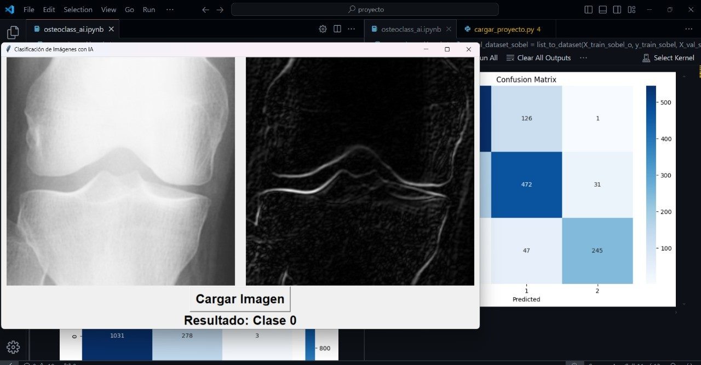

# OsteoClassAI

**Knee osteoarthritis grading from X-rays with deep learning (Kellgren-Lawrence scale).**

This repository holds two versions of the same project:

| | v1 (2024) | v2 (2026) |
|---|---|---|
| Context | Course project, Electromedicine, Universidad de Ibagué. Shown at the 48th METIE | Personal follow-up that fixes the v1 methodology |
| Input | Sobel edge maps | Original radiographs |
| Model | VGG19 + custom attention layers (Keras) | ConvNeXt-Tiny (PyTorch, timm), class-balanced training |
| Classes | 3 groups (KL0 / KL1–2 / KL3–4) | 5 KL grades + binary KL ≥ 2 |
| Split | Random, per image (leaks) | Original **patient-disjoint** split, audited |
| Test result, 3 classes | 77.1% accuracy (inflated by leakage, see below) | **78.6%** (95% CI 76.4–80.7%) on a clean, patient-disjoint test set |
| Test result, 5 grades | – | **QWK 0.851**, 67.3% accuracy; KL ≥ 2: AUC 0.943, sens. 77.5%, spec. 94.7% |
| Folder | [`v1-2024/`](v1-2024/) | [`v2/`](v2/) |

## Lessons learned from v1

Reviewing the 2024 code two years later, I found four problems that make its 77% accuracy an overestimate. They are the reason for v2.

1. **Duplicated images across train and test.** The project used 16,520 images, which is exactly twice the 8,260 images of the source dataset in every class (for example, 6,506 vs. 3,253 for KL0). Every radiograph appeared twice and the images were split at random, so copies of the same knee ended up on both sides.
2. **Same patient on both sides.** File names carry the Osteoarthritis Initiative patient ID and the knee (`9003175_1.png`, `9003175_2.png`). The original dataset is already split by patient: 4,130 patients, two knees each, and no patient in more than one split (checked in the [v2 audit](v2/)). v1 merged the three splits and re-split them at random per image, so one knee of a patient could land in training and the other in testing.
3. **Test data used for model selection.** The set passed as `validation_data` drove early stopping and learning-rate reduction. Only the third set (1,636 images) was untouched, and even that one is affected by points 1 and 2.
4. **Attention layers that do not do what they say.** `SelfAttention` multiplies 4-D tensors, so it attends only along the width of each row instead of over the whole image. `MultiScaleAttention.get_config` refers to an attribute that is never set, which breaks saving and reloading the model.

Other choices worth revisiting:
- Using only Sobel edges discards bone texture and sclerosis, which matter for KL grading.
- Vertical flips are not anatomically realistic for knee X-rays.
- Grouping KL1 with KL2 departs from the usual definition of radiographic OA (KL ≥ 2).
- Accuracy alone hides the ordinal nature of the scale. The standard metric is quadratic weighted kappa.

## Data

Both versions use the public **Knee Osteoarthritis Dataset with Severity Grading** (Chen et al., derived from the Osteoarthritis Initiative), available on [Kaggle](https://www.kaggle.com/datasets/shashwatwork/knee-osteoarthritis-dataset-with-severity). Images are not included in this repository.

## Team

**v1 (2024):** Walter Andrés Cárdenas Barrios, Diego Esteban Zapata Sánchez, Karol Julieta Rivera Gaitán. Advisor: Luisa Fernanda Gallo Sánchez (Electromedicine course).
**v2 (2026):** Walter Andrés Cárdenas Barrios.

Universidad de Ibagué, Electronic Engineering.

## Disclaimer

Research and educational project. Not a medical device and not validated for clinical use.

## License

[MIT](LICENSE)
