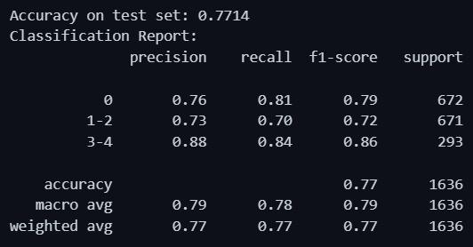
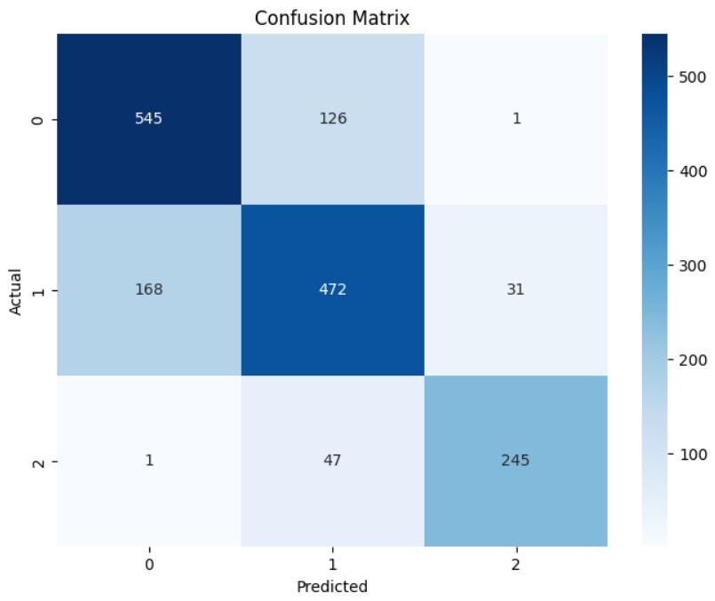

# v1 (2024): course project

Electromedicine course, Universidad de Ibagué, second semester of 2024. Presented at the **48th METIE** (student exhibition of Electronic Engineering projects).

## What it did

1. Loaded the five KL grades from the `train/val/test` folders of the dataset, preprocessed as Sobel edge maps, and regrouped them into three classes: **0** (healthy, KL0), **1** (mild or moderate, KL1–2) and **2** (severe, KL3–4).
2. Converted the grayscale images to 3 channels at 224 × 224 px, normalized them with ImageNet statistics, and applied augmentation (vertical flip, brightness, contrast, zoom).
3. Trained **VGG19** (ImageNet weights) with two custom layers (`SelfAttention`, `MultiScaleAttention`) and a dense head, in two stages: frozen backbone, then fine-tuning of the last 10 layers. Adam (lr 1e-4), up to 50 epochs, early stopping.
4. Desktop interface (Tkinter): load an X-ray, see the original and its Sobel version, and read the predicted class.

## Reported results

| Set | Images | Accuracy | Macro F1 |
|---|---|---|---|
| Never used during training ("validation" in the article) | 1,636 | 77.1% | 0.79 |
| Used for early stopping ("test" in the article) | 3,320 | 75.0% | 0.77 |

  
  

The model almost never confused healthy and severe knees; most errors were between neighboring classes. **These numbers are overestimated** because of duplicated images and patient overlap between the sets (see [Lessons learned](../README.md#lessons-learned-from-v1)).

## Files

| File | Content |
|---|---|
| [`notebook/osteoclassai_v1.ipynb`](notebook/osteoclassai_v1.ipynb) | Original training notebook. Only change: restored indentation in `matriz_confusion`, lost when saving from Colab |
| [`docs/articulo_osteoclassai_2024.pdf`](docs/articulo_osteoclassai_2024.pdf) | Course article (Spanish) |
| [`media/`](media/) | Classification reports, confusion matrices and interface screenshot from the article |

Not preserved: the script that generated the Sobel images, the Tkinter interface and the trained `.h5` model.

## Stack

Python, TensorFlow/Keras, scikit-learn, NumPy, Matplotlib, Seaborn, Tkinter.
