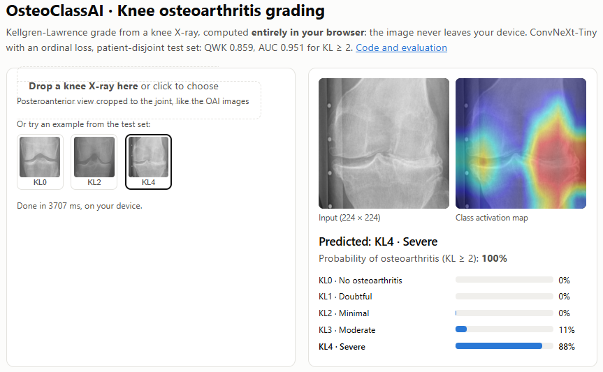

# v2 (2026): corrected pipeline

## Data audit

Run `python -m osteoclass.data --root <dataset> --out outputs/data` on the Kaggle dataset (Chen et al., 2019; OAI baseline radiographs):

| Check | Result |
|---|---|
| Images (train / val / test) | 5,778 / 826 / 1,656 = 8,260 |
| Patients | 4,130, two knees each |
| Patients in more than one split | **0** |
| Exact or near duplicates | **0** |
| `auto_test` | Automatic crops of the same 811 test patients, so it is excluded |

The original split is already patient-disjoint, so v2 keeps it. That also makes the results comparable with published work on this dataset. The v1 leakage came from the project itself (doubled images and a random per-image re-split), not from the dataset.

## Baseline: ConvNeXt-Tiny, 5 KL grades

ImageNet-pretrained `convnext_tiny` (timm), 224 × 224, class-weighted cross-entropy with label smoothing, AdamW + one-cycle LR, horizontal flip, ±10° rotation, scale and brightness/contrast augmentation. Model selection on `val` (QWK); `test` evaluated once with the best checkpoint (epoch 9, early stop at 15). Trained on a Colab T4 in about 11 min.

**Test set: 1,656 knees, 828 patients.** 95% CIs from 1,000 bootstrap resamples of patients.

| Metric | Value | 95% CI |
|---|---|---|
| Quadratic weighted kappa | **0.851** | 0.834 – 0.867 |
| Accuracy (5 grades) | 67.3% | 65.0 – 69.8% |
| Macro F1 | 0.714 | 0.689 – 0.737 |
| Mean absolute error (grades) | 0.353 | 0.324 – 0.379 |
| **OA (KL ≥ 2)** sensitivity | 77.5% | 74.3 – 80.7% |
| **OA (KL ≥ 2)** specificity | 94.7% | 93.2 – 96.2% |
| **OA (KL ≥ 2)** ROC AUC | **0.943** | 0.931 – 0.955 |

**Same grouping as v1** (KL0 / KL1–2 / KL3–4), computed from the same predictions: **78.6% accuracy** (95% CI 76.4 – 80.7%), macro F1 0.807. That is on a clean, patient-disjoint test set, and it is already above the 77.1% that v1 reported with leakage.

For reference, Chen et al. (2019), who released this dataset, reported 69.7% accuracy and MAE 0.344 with VGG-19 and an ordinal loss. This baseline is in the same range with plain cross-entropy.

  
  = 2 on the test set">

Most errors are between neighboring grades, and KL1 ("doubtful") is the hardest class: radiologists also disagree most on it. No KL0 knee was predicted as KL3–4, and no KL4 knee as KL0–2.

## Improvement 1: ordinal loss and test-time flip

KL grades are ordered, so predicting KL3 for a KL4 knee should cost less than predicting KL0. Cross-entropy ignores that. These runs replace it with **SORD** (soft ordinal labels, Díaz & Marathe 2019): the target is a softmax over −α·|k − y|² (α = 2), so neighboring grades get some probability. Predictions average the image and its left-right mirror (TTA). As an option, the expected grade Σ k·p(k) is also mapped to a grade with cut points tuned **on validation only**.

Two runs, same recipe as the baseline otherwise: A at 224 px and B at 288 px. The final model is chosen on validation (QWK with cut points: A 0.852, **B 0.859**); `test` was then evaluated once for each.

**Test set: 1,656 knees, 828 patients**, 95% CIs from 1,000 patient bootstrap resamples.

| Model | Decoding | Accuracy (5 grades) | QWK | MAE | AUC (KL ≥ 2) |
|---|---|---|---|---|---|
| Baseline (CE, 224 px) | argmax | 67.3% | 0.851 (0.834–0.867) | 0.353 | 0.943 |
| A (SORD + TTA, 224 px) | argmax | 70.1% (67.6–72.5) | 0.859 (0.840–0.876) | 0.334 | 0.951 (0.940–0.960) |
| A | cut points | 71.0% | 0.864 (0.846–0.881) | 0.322 | – |
| **B (SORD + TTA, 288 px)** | **argmax** | **70.4% (68.0–72.8)** | **0.867 (0.850–0.884)** | **0.327** | **0.955 (0.945–0.964)** |
| B | cut points | 67.9% | 0.866 | 0.346 | – |
| Chen et al. (2019) | – | 69.7% | – | 0.344 | – |

B with argmax, KL ≥ 2: sensitivity 77.1%, specificity 94.8%. Grouped as in v1 (KL0 / KL1–2 / KL3–4): **81.3%** (95% CI 79.2–83.2%), against 78.6% for the baseline and the 77.1% that v1 reported with leakage.

What this shows:
- The ordinal loss plus TTA is the clear gain: QWK 0.851 → 0.859–0.867 and AUC 0.943 → 0.951–0.955, now above Chen et al. in accuracy and MAE.
- 288 px adds little on top of it: the A and B intervals overlap.
- The cut points helped on validation and for A on test, but not for B (accuracy drops to 67.9%). They are kept as an option, not as the default.

Run: `notebooks/05_ordinal.ipynb` (`python -m osteoclass.train ... --loss sord --tta [--size 288]`).

## Where the model looks (Grad-CAM)

On one correctly classified test knee per grade, the heat maps sit on the **tibiofemoral joint space**: the medial and lateral margins, where joint-space narrowing and osteophytes show up, and the tibial spines. For KL3–4 the attention concentrates on the most damaged compartment. The model is not relying on text, markers or image borders. These are five examples chosen among correct predictions, so they illustrate the behavior but do not prove it for every image.

## Live demo

**<https://huggingface.co/spaces/walterandres23/osteoclassai>**

The demo runs **model D** (224 px, robustness augmentation, see Improvement 2): as good as B on the Chen test set, much less sensitive to other scanners and crops, and fast in the browser. Like the evaluation, it averages the image and its mirror. The model is exported to ONNX (`osteoclass.export_onnx`) with two outputs: the logits and a class activation map (the classifier applied at every location of the last feature map, so no gradients are needed). Weights are stored as int8 per output channel and dequantized on load: 111 MB → 28 MB, with **100% agreement** with the float model on 300 test images. The page (`web/index.html`) runs it with ONNX Runtime Web in about 4 s on a laptop CPU (two passes, image and mirror), and the X-ray never leaves the device. Hosted as a free static Hugging Face Space (`notebooks/04_publicar_demo.ipynb`).

`app/` holds an equivalent Gradio version with Grad-CAM, for running locally (`python app/app.py` with `best.pt` next to it).

## External test: Digital Knee X-ray Images (Gornale & Patravali)

Does the model work on X-rays from another hospital, scanner and set of readers? The models were tested **frozen**, without retraining, on the Digital Knee X-ray Images dataset (Gornale & Patravali, Mendeley Data 2020, CC BY 4.0): radiographs from hospitals in India (PROTEC PRS 500E), graded by two experts.

**The protocol was fixed and committed before any prediction was made.** It is written at the top of `src/osteoclass/external.py`.

**Audit first.** The dataset needed cleaning before it could be used as a test set:

| Check | Result |
|---|---|
| Files | 1,650 per expert; both folders hold the **same images** |
| Agreement between the two experts | 99.3% exact, QWK 0.998: in practice **one set of labels** (independent radiologists reach kappa ≈ 0.56–0.89) |
| Exact copies | 71, leaving 1,579 unique images |
| Near-duplicates | The same knee with another exposure or contrast: **1,377 distinct knees** at most |
| Same knee, different grades | 9 groups |
| Bilateral images, one grade for both knees | 109 |

The near-duplicates likely explain the near-perfect accuracy reported with cross-validation on this dataset: the same knee falls in both training and test folds, the same kind of leakage that v1 had.

**Main analysis:** 1,251 single knees (KL0 343, KL1 394, KL2 164, KL3 148, KL4 202), expert I labels, one image per knee, padded to a square. 95% CIs from 1,000 bootstrap resamples of knees.

| Model | QWK | Accuracy | MAE | AUC (KL ≥ 2) |
|---|---|---|---|---|
| Baseline (CE, 224 px) | 0.371 | 23.3% | 1.28 | 0.871 |
| A (SORD + TTA, 224 px) | 0.292 | 21.3% | 1.42 | 0.882 |
| **B (SORD + TTA, 288 px)** | **0.372** (0.341–0.401) | **24.9%** (22.5–27.3%) | **1.31** | **0.873** (0.853–0.892) |
| *B on the Chen test set* | *0.867* | *70.4%* | *0.33* | *0.955* |

**The models do not transfer as they are.** They keep the order of the grades (AUC ≈ 0.87, Spearman 0.75) but grade almost every knee about two grades too high: the mean expected grade for KL0 knees is 2.0, and for KL4 knees 3.6. With KL ≥ 2 as the threshold, sensitivity is 99% and specificity 10%. Secondary analyses, also declared in advance: stretching the image instead of padding it gives QWK 0.57–0.66, and bilateral images 0.21–0.32.

**Why: exploratory analyses, added after seeing the results** and reported apart from the main ones (`--exploratory`):

- *Scale.* The Gornale crops are much wider than the Chen crops, so a padded knee is about half the size the model was trained on, and the joint space looks narrower. A square crop centered on the joint, with the field of view of the Chen crops (located from intensity profiles, no training), raises B from QWK 0.372 to **0.550** (0.516–0.581). The over-grading shrinks but remains (accuracy 29.7%).
- *Calibration.* Fitting the four expected-grade cut points on half of the knees and scoring the other half (20 random splits, both directions) gives B QWK **0.756** (0.730–0.781) with padding and **0.785** (0.749–0.810) with the joint crop (accuracy 51%, 3-class accuracy 72%). This uses labeled knees from the new site, so it is a result *with local adaptation*, not an external result.

| B, Gornale | Kind | QWK | Accuracy |
|---|---|---|---|
| Padded | **Main** | 0.372 | 24.9% |
| Stretched | Sensitivity, pre-declared | 0.626 | 33.6% |
| Joint-centered crop | Exploratory | 0.550 | 29.7% |
| Padded + recalibration | Exploratory, local adaptation | 0.756 | 50.6% |
| Joint crop + recalibration | Exploratory, local adaptation | 0.785 | 50.8% |

**What this means:**
- A model that scores QWK 0.87 on its own test set can fall to 0.37 at another site. The internal number says nothing about deployment.
- Most of the drop is a **shift in scale**, not a loss of ranking: part comes from how the knee is cropped, part is a calibration offset that a few hundred labeled local knees correct.
- Even after both fixes, B stays below its internal performance (0.79 vs 0.87). That remaining gap may come from the images (scanner, processing) or from the readers grading differently from the OAI readers; this dataset cannot separate the two.
- Gornale has now been examined in detail, so it can no longer serve as an unbiased test for decisions taken because of it. Any robustness change will be confirmed on another source.

Run: `notebooks/06_externa_gornale.ipynb` (`python -m osteoclass.external --root <...> --runs <run folders> [--exploratory]`).

## Improvement 2: robustness augmentation

The external test showed that the model depends on the scale of the knee and on how the image was processed. Run **C** keeps B's recipe (SORD + TTA, 288 px) and adds `--aug robust`: zoom out to 0.6× with black borders and in to 1.15×, blank top/bottom bands (25% of images), wider brightness/contrast, gamma 0.7–1.4, sharpening and blur. Model selection and the single test evaluation follow the same rules as before.

**Chen test set** (1,656 knees). Differences from a paired bootstrap over patients (2,000 resamples):

| | B | C (robust) | C − B (95% CI) |
|---|---|---|---|
| QWK | **0.867** | 0.854 | −0.013 (−0.025 to −0.000) |
| Accuracy | **70.4%** | 66.8% | −3.6 pp (−5.7 to −1.5) |
| MAE | **0.327** | 0.356 | +0.029 (+0.005 to +0.052) |
| AUC (KL ≥ 2) | **0.955** | 0.945 | −0.009 (−0.015 to −0.003) |

B also wins on validation (QWK with cut points 0.859 vs 0.856), so **B remains the reference model**.

**Gornale.** This is no longer an unbiased test, because the augmentation was designed after looking at it. It shows the direction of the change, not a proof of generalization:

| | B | C (robust) |
|---|---|---|
| QWK, main analysis (padded) | 0.372 | **0.614** (0.583–0.642) |
| AUC (KL ≥ 2) | 0.873 | **0.911** |
| Joint-centered crop (exploratory) | 0.550 | **0.655** |
| Recalibrated, padded (exploratory) | 0.756 | **0.820** |

**At 224 px the augmentation costs nothing on the source.** Run **D** is A's recipe (SORD + TTA, 224 px) with `--aug robust`:

| Chen test set | A | D (robust) | D − A (95% CI) |
|---|---|---|---|
| QWK | 0.859 | **0.867** | +0.008 (−0.002 to +0.020) |
| Accuracy | 70.1% | 70.2% | +0.1 pp (−1.7 to +1.8) |
| MAE | 0.334 | 0.324 | −0.010 (−0.029 to +0.009) |
| AUC (KL ≥ 2) | 0.951 | 0.950 | −0.001 (−0.005 to +0.004) |

On Gornale, D goes from A's 0.292 to **0.570** (0.536–0.601), AUC 0.907, and 0.823 after recalibration. D also matches B on the Chen test set (QWK difference +0.000, −0.010 to +0.011), but B is still slightly ahead on validation (0.859 vs 0.855), so the rule keeps B as the reference. Why the cost appears at 288 px (C) and not at 224 px (D) is not clear from two runs; it may be run-to-run variation.

**Reading:** the augmentation almost doubles the uncalibrated agreement at the other site and lifts it to 0.82 with local recalibration, at the cost of about one hundredth of QWK and 3.6 points of accuracy on the source test set. That is the usual trade-off between fitting one source and generalizing to others. B stays as the benchmark model; a robust model is the better choice for the public demo, where users upload X-rays from any scanner and with any crop.

Run: `notebooks/07_robustez.ipynb` (C) and `notebooks/08_demo_robusta.ipynb` (D), with `python -m osteoclass.train ... --loss sord --tta --aug robust [--size 288]`.

## Improvement 3: ensemble of the trained runs

Higher resolution was dropped: the Chen images are 224 × 224, so 384 px would only enlarge existing pixels (288 px barely helped, B vs A). Instead, the four runs are combined by averaging the class probabilities each one already saved, with no new training (`osteoclass.ensemble`). The protocol was fixed before looking at the test set: every combination of two or more runs, equal weights, expected-grade cut points fitted on validation, the ensemble with the best validation QWK selected (ties to the smaller one), and the test set evaluated once for the selected ensemble and for all four runs (pre-declared sensitivity analysis).

Validation selected **B + C + D** (QWK 0.867). **Chen test set** (1,656 knees), all with validation-fitted cut points; differences from a paired bootstrap over patients (2,000 resamples):

| | B | B + C + D (selected) | All four |
|---|---|---|---|
| QWK | 0.866 | 0.871 | **0.874** |
| Accuracy | 67.9% | 69.4% | **70.2%** |
| MAE | 0.346 | 0.323 | **0.316** |
| AUC (KL ≥ 2) | 0.955 | 0.954 | 0.955 |
| QWK − B (95% CI) | | +0.005 (−0.004 to +0.014) | +0.008 (−0.001 to +0.016) |
| Accuracy − B | | +1.5 pp (−0.3 to +3.4) | +2.3 pp (+0.5 to +4.1) |
| MAE − B | | −0.023 (−0.042 to −0.004) | −0.030 (−0.049 to −0.010) |

**Reading:** the ensemble makes smaller errors (MAE improves clearly in both versions) but the QWK gain, under one hundredth, is within the noise. The internal ceiling of this recipe on this dataset appears to be near QWK 0.87; further gains on the source are small compared with the external drop (0.87 → 0.57 for D). B stays as the single reference model, the ensemble is reported as the best internal result, and the demo keeps D alone: three models would triple the time in the browser (about 4 s → 12 s) for a gain that is not significant.

Run: `notebooks/09_ensamble.ipynb` (CPU; `python -m osteoclass.ensemble --runs <B> <A> <C> <D> --names B A C D`).

## Improvement 4: knee-joint detector

The external test showed that the main problem on a new source is **scale**: the classifiers were trained on crops of a fixed field of view, and an image prepared any other way is graded higher. A detector now finds each knee and crops it at that same field of view.

**Data.** Chen et al. also published the data behind their own detector (KneeXrayData, doi:10.17632/56rmx5bjcr.1, CC BY 4.0): 4,130 full bilateral OAI radiographs (256 × 320) with a box per knee, in **the same patient split** as the KL crops (2,889 / 413 / 828), so training on its train part does not touch our test set. Matching every KneeKL224 crop back into its radiograph (400 knees, median correlation 0.985) gives the crop rule: **a square of 1.30 × the box width, centered on the box** (80% of knees between 1.27 and 1.34; center offset under 1%); no mirroring; the right knee is on the left of the image (`osteoclass.detdata`).

**Detector** (`osteoclass.detect`): a small CenterNet on ResNet-18 that predicts, at stride 4, a heatmap of knee centers, their sub-pixel offset and the box width. Training adds single-knee views with the joint larger in the frame, zoom, mirroring, contrast, gamma, blur and noise, so that it also works on other sources. 40 epochs (~12 min on a T4), best epoch by the crop IoU on validation, test evaluated once:

| DetKneeData test (828 radiographs, 1,656 knees) | |
|---|---|
| Knees found | **100%**, no extra detections |
| IoU of the crop given to the classifier, mean | **0.916** |
| Crops with IoU ≥ 0.8 | 98.9% |
| Center error, median (fraction of box width) | 3.1% |
| Width error, median | 2.4% |

**On Gornale** (exploratory: this dataset had already informed earlier decisions; the detector never saw it). Frozen classifiers; same protocol, metrics and bootstrap as the external test. The detector found a knee in all 1,251 single-knee images and both knees in 101 of 109 bilateral ones.

| QWK on Gornale (95% CI) | B | D |
|---|---|---|
| Padded to square (main analysis) | 0.372 (0.341–0.401) | 0.570 (0.536–0.601) |
| Joint crop by hand-made rule | 0.550 (0.516–0.581) | 0.599 (0.566–0.628) |
| **Detector crop** | **0.652** (0.621–0.679) | **0.645** (0.615–0.671) |
| AUC KL ≥ 2, detector crop | 0.898 | **0.917** |
| Bilateral images: padded halves → detector | 0.279 → 0.437 | 0.443 → 0.514 |
| Split-half recalibrated, detector crop | 0.802 | 0.809 |

**Reading:** cropping at the training scale is worth +0.28 QWK for B, more than the robustness augmentation (+0.20), and with the right crop B and D perform the same: most of what the augmentation bought was tolerance to the wrong scale. What the detector does not fix is the grade calibration: accuracy stays near 35% because both models still grade higher than these experts; with cut points fitted on half of the knees every crop reaches about 0.80. Scale and calibration are separate problems and a deployment needs both.

Run: `notebooks/10_detector_datos.ipynb` (data and crop rule, CPU), `notebooks/11_detector_entrenamiento.ipynb` (training, T4), `notebooks/12_detector_gornale.ipynb` (Gornale, T4).

## Next

1. Put the detector in the web demo (ONNX), before the classifier, showing the detected box, so that full radiographs can be graded.
2. A local calibration step (cut points fitted on a small labeled sample) as part of deploying at a new site, with an estimate of how many knees it needs.
3. External validation on a cohort not used for any decision (MOST), with access requested through the NIA AgingResearchBiobank.

## How to run

`notebooks/02_entrenamiento.ipynb` (Colab, GPU): clones this repo, downloads the dataset with `kagglehub`, runs the audit and the training, and copies the results to Google Drive.

Locally: `pip install -e .` then `python -m osteoclass.data ...` and `python -m osteoclass.train --root <dataset> --splits outputs/data/splits.csv`. Figures: `python -m osteoclass.figures --run <run folder> --out media`. Tests: `pytest -q tests`.

## References

Chen P, Gao L, Shi X, Allen K, Yang L. Fully automatic knee osteoarthritis severity grading using deep neural networks with a novel ordinal loss. *Computerized Medical Imaging and Graphics* 75 (2019) 84–92. doi:10.1016/j.compmedimag.2019.06.002

Díaz R, Marathe A. Soft labels for ordinal regression. *CVPR* 2019, 4738–4747.

Chen P. Knee Osteoarthritis Severity Grading Dataset. *Mendeley Data* V1 (2018). doi:10.17632/56rmx5bjcr.1

Gornale SS, Patravali PU. Digital Knee X-ray Images. *Mendeley Data* V1 (2020). doi:10.17632/t9ndx37v5h.1

Tiulpin A, Thevenot J, Rahtu E, Lehenkari P, Saarakkala S. Automatic knee osteoarthritis diagnosis from plain radiographs: a deep learning-based approach. *Scientific Reports* 8 (2018) 1727. doi:10.1038/s41598-018-20132-7
