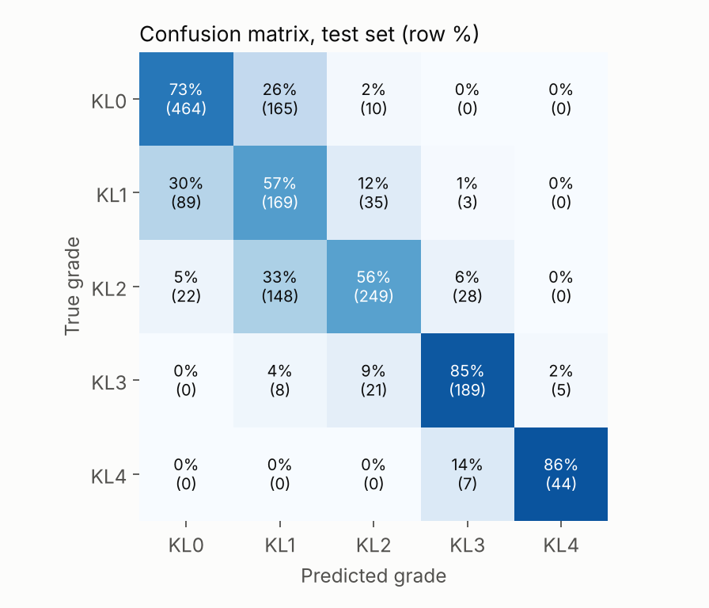
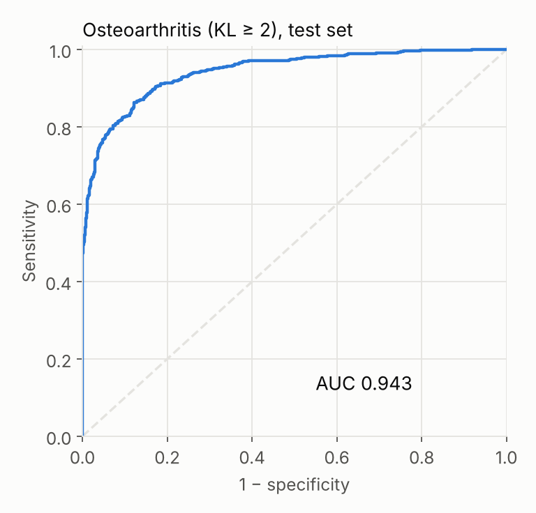
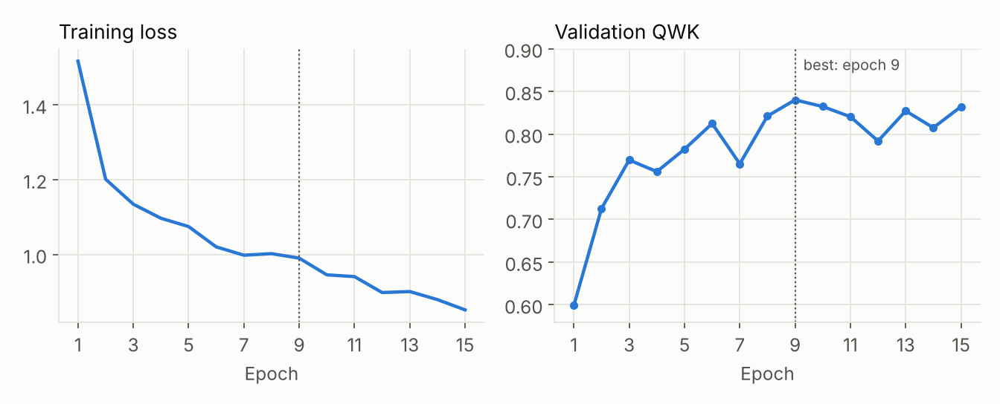
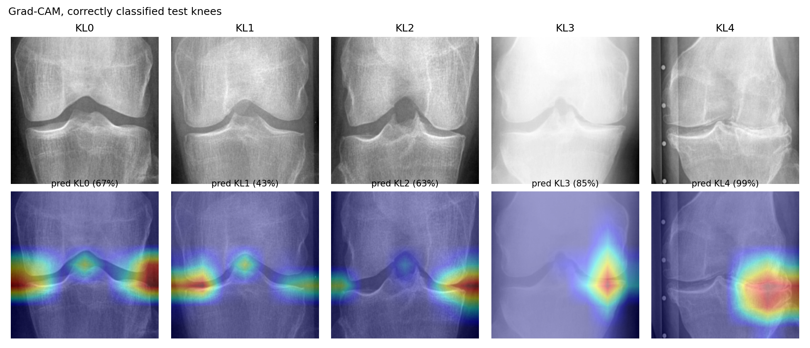

# v2 (2026): corrected pipeline

## Data audit

Run `python -m osteoclass.data --root <dataset> --out outputs/data` on the Kaggle dataset (Chen et al., 2019; OAI baseline radiographs):

| Check | Result |
|---|---|
| Images (train / val / test) | 5,778 / 826 / 1,656 = 8,260 |
| Patients | 4,130, two knees each |
| Patients in more than one split | **0** |
| Exact or near duplicates | **0** |
| `auto_test` | Automatic crops of the same 811 test patients, so it is excluded |

The original split is already patient-disjoint, so v2 keeps it. That also makes the results comparable with published work on this dataset. The v1 leakage came from the project itself (doubled images and a random per-image re-split), not from the dataset.

## Baseline: ConvNeXt-Tiny, 5 KL grades

ImageNet-pretrained `convnext_tiny` (timm), 224 × 224, class-weighted cross-entropy with label smoothing, AdamW + one-cycle LR, horizontal flip, ±10° rotation, scale and brightness/contrast augmentation. Model selection on `val` (QWK); `test` evaluated once with the best checkpoint (epoch 9, early stop at 15). Trained on a Colab T4 in about 11 min.

**Test set: 1,656 knees, 828 patients.** 95% CIs from 1,000 bootstrap resamples of patients.

| Metric | Value | 95% CI |
|---|---|---|
| Quadratic weighted kappa | **0.851** | 0.834 – 0.867 |
| Accuracy (5 grades) | 67.3% | 65.0 – 69.8% |
| Macro F1 | 0.714 | 0.689 – 0.737 |
| Mean absolute error (grades) | 0.353 | 0.324 – 0.379 |
| **OA (KL ≥ 2)** sensitivity | 77.5% | 74.3 – 80.7% |
| **OA (KL ≥ 2)** specificity | 94.7% | 93.2 – 96.2% |
| **OA (KL ≥ 2)** ROC AUC | **0.943** | 0.931 – 0.955 |

**Same grouping as v1** (KL0 / KL1–2 / KL3–4), computed from the same predictions: **78.6% accuracy** (95% CI 76.4 – 80.7%), macro F1 0.807. That is on a clean, patient-disjoint test set, and it is already above the 77.1% that v1 reported with leakage.

For reference, Chen et al. (2019), who released this dataset, reported 69.7% accuracy and MAE 0.344 with VGG-19 and an ordinal loss. This baseline is in the same range with plain cross-entropy.

  
  = 2 on the test set">

Most errors are between neighboring grades, and KL1 ("doubtful") is the hardest class: radiologists also disagree most on it. No KL0 knee was predicted as KL3–4, and no KL4 knee as KL0–2.

## Where the model looks (Grad-CAM)

On one correctly classified test knee per grade, the heat maps sit on the **tibiofemoral joint space**: the medial and lateral margins, where joint-space narrowing and osteophytes show up, and the tibial spines. For KL3–4 the attention concentrates on the most damaged compartment. The model is not relying on text, markers or image borders. These are five examples chosen among correct predictions, so they illustrate the behavior but do not prove it for every image.

## Next

1. Ordinal-aware training (ordinal loss or CORAL) and higher resolution.
2. Small web demo: upload an X-ray, get the grade and the heat map.

## How to run

`notebooks/02_entrenamiento.ipynb` (Colab, GPU): clones this repo, downloads the dataset with `kagglehub`, runs the audit and the training, and copies the results to Google Drive.

Locally: `pip install -e .` then `python -m osteoclass.data ...` and `python -m osteoclass.train --root <dataset> --splits outputs/data/splits.csv`. Figures: `python -m osteoclass.figures --run <run folder> --out media`. Tests: `pytest -q tests`.

## Reference

Chen P, Gao L, Shi X, Allen K, Yang L. Fully automatic knee osteoarthritis severity grading using deep neural networks with a novel ordinal loss. *Computerized Medical Imaging and Graphics* 75 (2019) 84–92. doi:10.1016/j.compmedimag.2019.06.002
